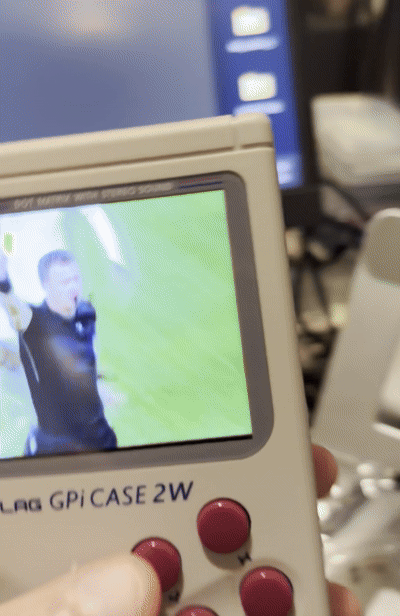
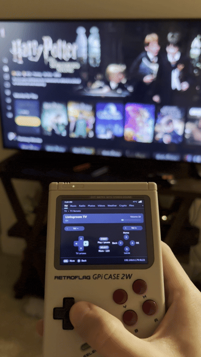
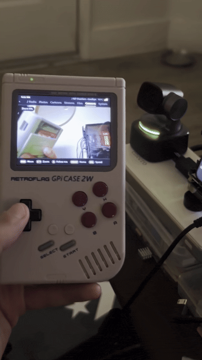
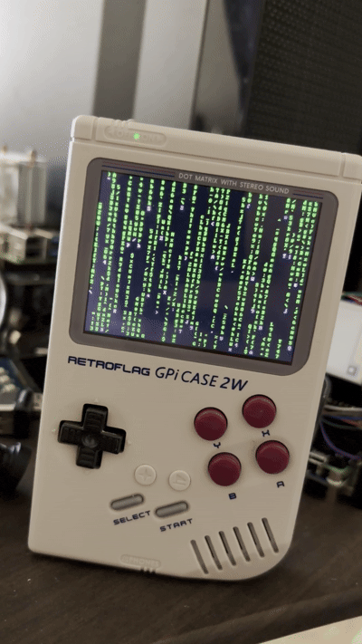
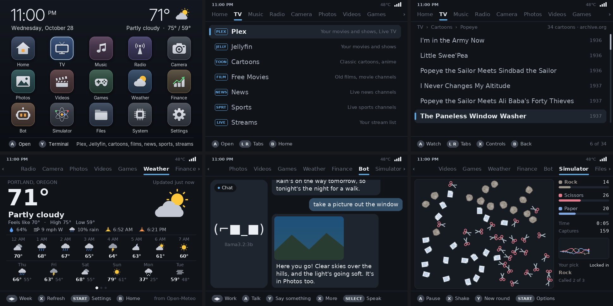

# Pitato

Turns your Raspberry Pi GPi Case 2W into a pocket-sized smart media center. Versatile home entertainment
remote where you can watch live TV, stream videos, listen to music and radio, view photos, play your own
games, check the weather and system stats, and control your smart home through Home Assistant. It works on
any Raspberry Pi with a TV or monitor on HDMI too.

<p>
  
  
  
  
</p>

## Install

On Raspberry Pi OS Lite (Bookworm):

```
git clone https://github.com/frogCaller/pitato.git
cd pitato
sudo bash setup.sh
```

It asks if the Pi is in a GPi Case 2W. If it is, it sets up the case's screen, speaker and
power switch: turn the SAFE SHUTDOWN switch behind the cartridge to ON, and switching the case
off shuts the Pi down safely. If not, it leaves HDMI as it is.
Then it installs `pitato.py` and the web page as services, sets the Pi to sign you in by
itself at start-up (`sudo bash setup.sh --login` keeps the password prompt), asks about the
optional parts, and reboots. The first time takes a while (an hour or more on a Pi 4, as it builds
the game emulators), so leave the Pi on until it says All set.

Keep the `pitato` folder where it is: your settings live in its `static` folder. To update
later, run `git pull` and `sudo bash setup.sh` again. Your settings stay as they are. If you set it
up when it was called gpi-media, do the same, and it moves everything across to the new name.

It starts on a home screen of apps:

- **Home Assistant**: a remote for your TVs, and your lights
- **TV**: Plex (Continue watching, Watchlist, Live TV with news and sports), Jellyfin, about 250 old
  cartoons and 150 old films from the Internet Archive, and your own streams
- **Music**, **Radio**, **Photos** (filters, delete), **Videos** (picks up where you left off)
- **Weather**, and **Finance**: stock and coin prices and charts. Press Y on Finance to look up more to add
- **Files**: PDFs, documents, text, pictures, video and music, on the Pi or on your other computers
- **Camera**: the cameras on your other Pis, or any camera link: switch between them with L and R,
  steer an OBSBOT, take pictures, and have your bot say what it sees
- **Bot**: talks through Ollama on another computer, sees through your camera and takes pictures,
  out loud if you give it a voice. At work, it acts out what your coding agent is doing, rings a
  bell when it's done, and sends it prompts you type
- **Simulator**: Rock Paper Scissors (pick a winner before the first capture), Game of Life, Orbits,
  Forest Fire and the Mandelbrot set, which takes you on dives (or press the d-pad to explore it,
  A to zoom in and Y to zoom out). Press SELECT to watch one full screen
- **Games**: Snake (press X and a decision model on your bot's computer plays it for you), and your own
  Game Boy, Game Boy Advance, NES, SNES, Genesis, Master System, Game Gear and PlayStation games, and
  N64, PSP and DS games on a Pi 4 or 5. Two can play on two controllers
- **System** and **Settings**: WiFi, Bluetooth, the home screen's style, background, colours, location,
  video size, a TV or monitor's resolution, sound, controller



## Controllers

The GPi Case's own buttons, or any USB or Bluetooth game controller (Xbox, PlayStation,
8BitDo, the cheap SNES-style ones). Plug them in any time.

- Home switches between the apps and the console, where the buttons work as keys (Up for the last
  command, A for Enter). To start in the console instead, set Settings > At start-up to Terminal.
- If your controller is Bluetooth, put it in pairing mode and pick it in Settings > Bluetooth, or
  under Bluetooth on the web page. Keyboards and headphones pair the same way, and while headphones
  are connected, sound plays through them. If they disconnect, what's playing pauses.
- If A and B are the wrong way round, use that controller to set Settings > Swap A and B to On.
- If a button does the wrong thing, open Settings > Controller and press each button it asks for.
- If your controller has no Home button, press Select and Start together.

## The web page

Open `http://<your Pi's IP address>:5432` on your phone or computer. Anyone on your WiFi
can open it, so if you share your WiFi, set a password in `webui.txt` (see Settings below).

**Screen** shows what's on the Pi's screen in media mode, has a remote, and puts cartoons,
films, news, sports, radio, a camera or any app on it. You can also talk to your bot there, and
pair Bluetooth devices.

**Files** takes files or whole folders dropped on it. Music, videos, pictures, documents and games
each go to their own folder, and settings files like `radio.txt` go to Settings. Each file can
be shown on the Pi's screen, downloaded or deleted. The Computers tab has your other computers' files.

## Cameras

Add a camera on the Camera tab or the web page by typing its address. It can be:

- a Pi with a USB camera: run `sudo bash setup.sh --camera` on it. If the camera turns (an OBSBOT,
  a PTZ webcam), the d-pad steers it.
- any MJPEG or JPEG camera link, such as an ESP32-CAM's

Pis running the camera server show up by themselves under On your network. If a camera is on its
side, press Y on it in your list of cameras to rotate its picture, and if it turns the wrong way when
you steer it, press ◀ or ▶ on it.

## Games

Put your games in the `Games` folder in your home folder. It has a folder for each: `gb`, `gbc`, `gba`,
`nes`, `snes`, `genesis`, `sms`, `gg` and `ps1`, and on a Pi 4 or 5, `n64`, `psp` and `nds`. You can also
drop them on the web page (zips work too, for the cartridge ones). They're played by mGBA, Nestopia,
Snes9x, Genesis Plus GX, PCSX ReARMed, Mupen64Plus-Next, PPSSPP and melonDS.

In a game, Home opens its menu: save or load a state, start over, the players, the volume, the picture
size, or quit. Quitting keeps your place for next time. If you want to play with someone, plug in or pair
a second controller: the one that started the game is player 1, and the next one to press a button is
player 2 (an N64 game takes four).

- N64: the right stick is the C buttons, and L2 is Z.
- DS (with the 64-bit Raspberry Pi OS): both screens side by side, and the right stick moves a pointer
  on the touch screen, with R2 to touch it.
- PlayStation: `.cue` and `.bin`, `.chd`, `.pbp` or `.m3u` files. Change discs in the game's menu.
- A BIOS isn't needed, but if you have one from your own console, put it in `Games/BIOS` and more
  PlayStation games work.

Press Y on the Games tab to find pictures of your games.

## Other computers

If you want another computer's files on the Pi, open Files, then Other computers, and add it by its
address (like `192.168.1.20`). On Windows or a Mac, share a folder first; on Linux, turn on SSH. Its
files open read-only, so nothing on that computer is changed from the Pi.

## Bot

If you run [Ollama](https://ollama.com) on a computer on your network, set its address and a
model in Settings > Bot, or on the web page. On that computer Ollama has to listen on the
network (`OLLAMA_HOST=0.0.0.0`). The bot knows the time, the weather, your stocks and coins, and
what's playing. Ask it to take a picture and your camera takes one, into Photos and the conversation.

With a model that can see (Gemma, LLaVA, Qwen-VL), it also looks through your camera now and then
and says what it sees, and looks at pictures you send it: press X on the Bot page to pick one from
Photos, or use the picture button on the web page to send one from your phone. Press SELECT on the
Camera tab, or Describe on the web page's Cameras, and it says what that camera sees.

If that computer has a decision model (Ollama 0.35 or newer: `ollama pull nimble`), press X in
Snake and the model plays. Pick which one in Snake's options (START), and Slow if it can't keep up.

If you pick a voice in Settings > Bot > Voice, it says its replies out loud with
[Piper](https://github.com/rhasspy/piper), which runs on the Pi. The first time, the Pi
downloads Piper (about 25 MB) and the voice (about 60 MB). The quick voices suit a Pi Zero
best. Press SELECT to hear the last reply again, or Say it out loud on the web page.

## Bot at work

Press left or right on the Bot to switch between chatting and work. At work it sits at a desk: it
reads when your coding agent reads, types when it writes code, waves when it needs you, and rings a
bell when it's done.

To connect Claude Code, run this on the computer it runs on:

```
curl -O http://<your Pi's IP address>:5432/coder_hooks.py
python3 coder_hooks.py <your Pi's IP address>
```

It adds hooks to Claude Code's settings that tell the Pi what Claude Code is doing. They run in
the background and do nothing when the Pi is off. `--remove` takes them out again.

The same script lets you send Claude Code prompts from the Pi. Start Claude Code like this:

```
claude --dangerously-load-development-channels server:pitato
```

Then press A at work, type a prompt, and press START. Claude Code gets it as if you had typed it.
This uses Claude Code's channels, which are a research preview: Claude Code asks you to confirm
each time it starts, and it needs to be signed in with a Claude account or an Anthropic API key.
If channels aren't available to you yet, Claude Code says so when it starts.

- If your web page has a password, add `--password` and the password.
- Prompts are only typed on the Pi itself. The web page's remote can't send them.
- If you only want the hooks, add `--no-prompts`.
- To have Claude Code use your Ollama models, start it with `ollama launch claude`
  ([Ollama's guide](https://docs.ollama.com/integrations/claude-code)). Prompts from the Pi
  need Claude Code signed in, though.
- Other agents and scripts can `POST /coder?pose=typing` (or `reading`, `thinking`, `done`...),
  and send a WAV to `POST /coder/say` to have it said out loud.

At work, A types a prompt, Y rings the bell, X turns its sounds off, and START shows these steps.

## Settings

All optional, in the `static` folder. Git leaves them out, so they stay off GitHub.

| File | What goes in it |
| --- | --- |
| `streams.txt`, `radio.txt` | your own streams and stations, `Name \| URL` per line |
| `finance.txt` | `stocks =` the stocks to show (tickers, as on Yahoo Finance) and `coins =` the coins (CoinGecko ids). Y on the Finance tab adds and removes them |
| `camera.txt` | `camera =` an address per line, a name after it if you like |
| `bot.txt` | `server =`, `model =`, `eyes =` (a model that can see) and `voice =` (Settings > Bot writes these) |
| `homeassistant.txt` | `url =` and `token =` (a long-lived access token). Your TVs and lights are found by themselves, and `lights =` picks which lights show |
| `jellyfin.txt` | `server =` if your Jellyfin server isn't found by itself, and `user =` and `password =` if you'd rather not use Quick Connect |
| `webui.txt` | `password =` if you want the web page to ask for one, `hosts =` other names you open it by |

Plex signs in with a code at plex.tv/link. Jellyfin signs in with a Quick Connect code: in Jellyfin on
your phone or computer, open your profile, then Quick Connect, and type the code.

If a video is too big for the Pi to play smoothly (a 1080p film on a Pi Zero, or one in HEVC), the Pi
makes it smaller by itself in the background. To keep your videos as they are, set Settings > Big
videos to Leave them.

## License

MIT, see [LICENSE](LICENSE). The fonts in `static/fonts` (Atkinson Hyperlegible Next and Inter) have their
own license, `OFL.txt`.
