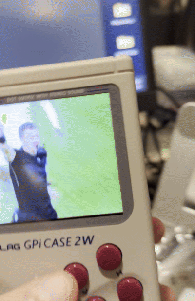
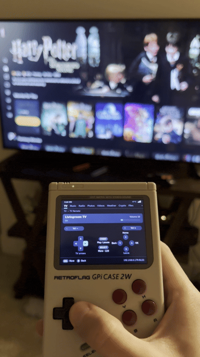
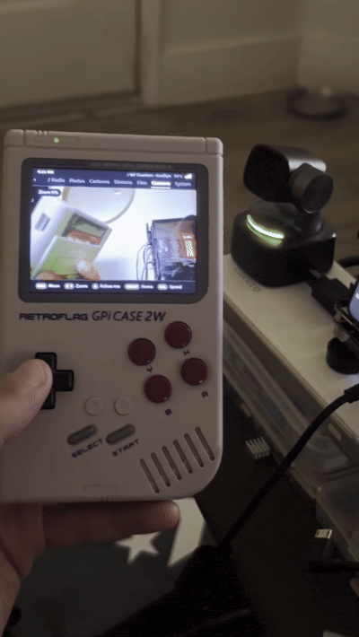
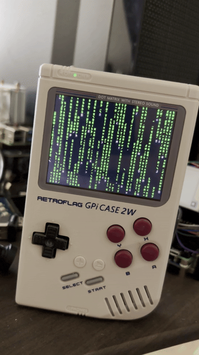

# Pietato

Turns your Raspberry Pi GPi Case 2W or GPi Case 2 into a pocket-sized smart media center. Versatile home
entertainment remote where you can watch live TV, stream videos, listen to music and radio, view photos, play
your own games, check the weather and system stats, and control your smart home through Home Assistant. It
works on any Raspberry Pi with a TV or monitor on HDMI too, on a regular PC with Ubuntu or Debian, and on an
R36S or a handheld like it with dArkOS.

<p>
  
  
  
  
</p>

## Install

The easy way is an SD card image, for any 64-bit Pi (Zero 2 W, 3, 4, 5 or a Compute Module 4): from the
[latest release](https://github.com/frogCaller/Pietato/releases/latest), the one ending in
`gpi-case-2w.img.xz` for the GPi Case 2W, `gpi-case-2.img.xz` for the GPi Case 2 (a Compute Module 4 without
eMMC starts from the card), or `hdmi.img.xz` for a TV or monitor. Write it to a microSD
card (8 GB or more) with [Raspberry Pi Imager](https://www.raspberrypi.com/software/), under Use custom,
adding your WiFi, time zone, username and password in its settings if you like (the WiFi can be set in
Pietato's Settings too). Without them, the user is `pi`, with no password until you set one
(`sudo passwd pi`).

Or set it up yourself, on Raspberry Pi OS Lite:

```
git clone https://github.com/frogCaller/Pietato.git
cd Pietato
sudo bash setup.sh
```

It asks a few questions first: whether the Pi is in a GPi Case, then Default for everything your Pi can run,
or Custom to pick, and your Home Assistant, Pi-hole, Ollama, Plex, Jellyfin and RetroAchievements if you have
them. In a GPi Case, turn the SAFE SHUTDOWN switch behind the cartridge to ON, so switching the case off shuts
the Pi down safely. The first time takes a while (an hour or more on a Pi 4 with everything in), so leave the
Pi on until it says All set.

The same commands set it up [on a PC](docs/pc.md) with Ubuntu 24.04 or Debian 12 or 13, and
[on an R36S](docs/handheld.md). To update, press Update software at the top of System's list: it puts in the
newest version. [Setting it up](docs/setup.md) has the rest: setup.sh's options, updating, and taking it off.

## More

- [The apps](docs/apps.md)
- [Controllers](docs/controllers.md)
- [The web page](docs/web-page.md)
- [Games](docs/games.md)
- [Cameras](docs/cameras.md)
- [Other computers](docs/computers.md)
- [The Bot](docs/bot.md)
- [Claude Code](docs/bot.md#claude-code)
- [Settings files](docs/settings.md)

## License

MIT, see [LICENSE](LICENSE). The fonts in `static/fonts` (Atkinson Hyperlegible Next and Inter) have their
own license, `OFL.txt`. The console pictures in `pitato/icons/consoles` are RetroArch's, under CC BY 4.0:
see `CREDITS.txt` there.
