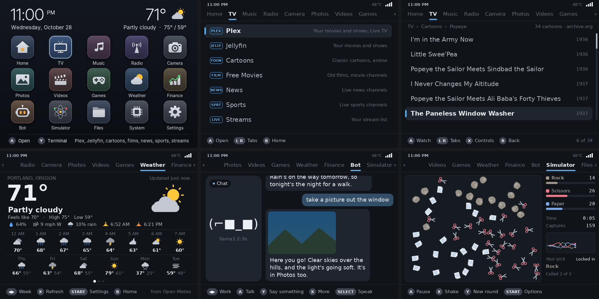

# The apps

Pietato starts on a home screen of apps:

- **Home**: a remote for your TVs and your lights (through Home Assistant), a dashboard of your
  Pi-hole's stats (from the Pi-hole itself: add it by its address), and Web, for browsing ([Web](#web), below).
  The first time you open the TV Remote or Lights, they ask for Home Assistant's IP address and a long-lived
  token (Settings > Home changes them later), or you can put them in on the web page's Settings
- **TV**: Plex (Continue watching, Watchlist, Live TV with news and sports), Jellyfin, about 250 old
  cartoons and 150 old films from the Internet Archive, and your own streams
- **Music** and **Radio** (on Now playing, SELECT puts on lofi art: a quiet scene on the whole screen),
  **Photos** (filters, delete), **Videos** (picks up where you left off)
- **Weather** (press START there to set where you are, and °F or °C), and **Finance**: stock and coin prices
  and charts. Press Y on Finance to look up more to add
- **Files**: PDFs, documents, text, pictures, video and music, on the Pi or on your other computers
- **Camera**: a USB camera plugged into the Pi (it shows up by itself), any camera on your network, or the ones
  on your other Pis: switch between them with L and R, steer an OBSBOT, take pictures, and have your bot say
  what it sees
- **Bot**: does what you ask, like setting a timer, adding to your list or playing some music, and chats
  through Ollama on another computer. It sees through your camera and takes pictures, and talks out loud if
  you give it a voice. At work, it acts out what your coding agent is doing, rings a bell when it's done,
  and sends it prompts you type
- **Apps**: a Clock with the time and the date (A switches between a dial and big figures, ◀▶ go through a
  dozen fonts, ▲▼ change its colour, X its background, Y turns the date on or off, and START has its seconds), Notes
  (type with a USB or Bluetooth keyboard: ▲▼ change the words' colour, ◀▶ the background, A the font, Y adds
  a glow, a rainbow or a shadow, X reads it out loud in your Bot's voice, and L and R go through your notes,
  kept in Documents/Notes), a Fortune Cookie (A shows a new fortune, ▲▼ and ◀▶ pick its colours as in Notes,
  L and R its font, Y an effect, and X reads your fortune and lucky numbers out loud), Rock Paper Scissors (pick a
  winner before the first capture), Game of Life, Forest Fire and the Mandelbrot set, which takes you on dives
  (or press the d-pad to explore it, A to zoom in and Y to zoom out). Press SELECT to watch one full screen.
  It can also start cmatrix, hollywood, nyancat, cacafire and htop without a keyboard: in cmatrix, ◀▶ change
  its colour and ▲▼ its speed; in htop, ▲▼ move through what's running and X or Y sort it by CPU or memory;
  and B stops any of them. Konami code saves button codes of your own: hold Home and press any button, then put
  in ▲▲▼◀▼▶A, say, to turn the TV on. A code can also turn the lights on or off, open an app, play a random song
  or your last game, or turn the screen off
- **Games**: Snake (press X and a decision model on your bot's computer plays it for you), and your own
  Game Boy, Game Boy Advance, NES, SNES, Genesis, Master System, Game Gear, Neo Geo, Neo Geo Pocket and
  PlayStation games, N64, PSP, DS and Dreamcast games on a Pi 4 or 5 or a PC, and PlayStation 2, GameCube
  and Wii games on a PC. Two can play on two controllers. Its icon on the home screen shows one of the
  consoles you have games for, a different one each time you come back to the home screen
- **System**: a dashboard of the Pi's temperature, how busy it is, its memory, storage and network. SELECT
  shows it as a list instead, with Update software, Reboot and Shut down
- **Settings**: WiFi, Bluetooth, the home screen's style, background, colours, video size, a TV or monitor's
  resolution, battery saver, sound, controller
- If you'd rather see the apps on the whole screen, set Settings > Full screen apps to On. The status
  bar, the tabs and the button hints go away, leaving just the app's name at the top. The buttons work
  the same, and L and R still switch apps
- If your screen is mounted on its side or upside down, Settings > Rotate screen turns the picture to
  match: the apps, games, videos and the console
- On a 1080p or 4K TV, a Pi 4 or 5 (or a PC) draws the menus in the TV's finer detail, so text, icons and
  pictures stay sharp
- On a battery (in a GPi Case, or on a laptop), the screen goes dark after three minutes with nothing
  happening, to save power. Music keeps playing, and any button wakes it. Settings > Battery saver turns
  this on or off on any Pi. Turning down the case's brightness saves the most

## Web

Web, in the Home tab, shows a page as its words, links and pictures, on any Pi. Sites made to be simple
work best, and a few are on its first page. Up and down go from link to link, A opens one, B goes back,
Start searches or goes to an address, Y bookmarks the page, and Select shows just the article.

On a Pi 4 or 5 or a PC (in a GPi Case 2, in its dock), Web's first page opens Chromium too, for the sites that
need it (setup.sh puts it in, about 300 MB). The stick or the d-pad moves the pointer, A clicks, B goes back, and
L and R scroll. X types into the page and Start goes to an address, with Pietato's keyboard. Home opens its menu,
for zoom, tabs, full screen, or closing it. A keyboard and a mouse work in it too. If it doesn't start,
`journalctl -u pietato-chromium` says why.
